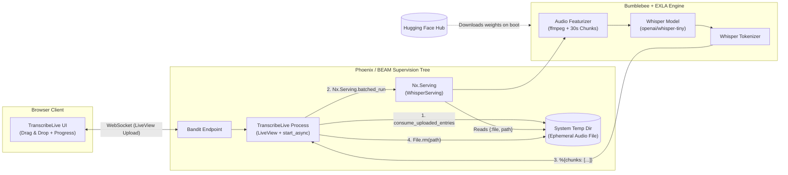
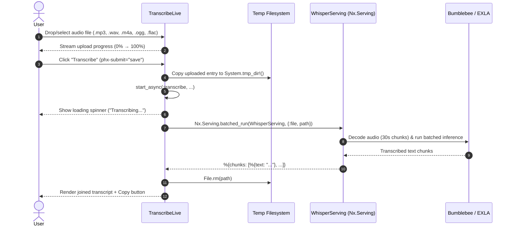

# WhisperApp

A real-time audio transcription web application built with **Elixir**, **Phoenix LiveView**, **Bumblebee**, **Nx**, and **EXLA**.

WhisperApp runs OpenAI's **Whisper** (`openai/whisper-tiny`) speech-to-text model directly inside the BEAM VM—no external Python microservices or third-party transcription APIs required.

---

## Features

- **On-Device ML Inference**: Runs `openai/whisper-tiny` locally via [Bumblebee](https://github.com/elixir-nx/bumblebee) and [EXLA](https://github.com/elixir-nx/nx/tree/main/exla) (XLA compiler backend).
- **Automatic Request Batching**: Uses `Nx.Serving` (`batch_size: 4`, `batch_timeout: 100ms`) with 30-second audio chunking for concurrent throughput.
- **Interactive LiveView Uploads**: Drag-and-drop file uploads with real-time progress bars, client-side validation, and upload cancellation.
- **Broad Format Support**: Accepts `.mp3`, `.wav`, `.m4a`, `.ogg`, and `.flac` audio files up to **50 MB**.
- **Non-Blocking UI**: Executes inference via LiveView's `start_async/3` and automatically cleans up temporary audio files once transcription finishes.

---

## Architecture & Workflow

### System Architecture



### Transcription Lifecycle



---

## Tech Stack

| Layer | Technology | Purpose |
| :--- | :--- | :--- |
| **Web Framework** | Phoenix `~> 1.8` & LiveView `~> 1.2` | Real-time UI, streaming file uploads, async tasks |
| **HTTP Server** | Bandit `~> 1.5` | Pure-Elixir HTTP/1.x, HTTP/2, and WebSocket server |
| **Neural Network** | Bumblebee `~> 0.6` | Pre-trained Hugging Face Whisper model integration |
| **Numerical Computing** | Nx `~> 0.9` & EXLA `~> 0.9` | Multi-dimensional tensors & Google XLA JIT compilation |
| **Styling** | Tailwind CSS `v4.3` + DaisyUI + Heroicons | Responsive UI components and icons |

---

## Prerequisites

1. **Elixir `~> 1.17`** and **Erlang/OTP 27+**
2. **FFmpeg**: Required by Bumblebee to decode audio files passed via `{:file, path}`.
   ```bash
   # Ubuntu / Debian
   sudo apt install ffmpeg

   # macOS
   brew install ffmpeg
   ```

---

## Getting Started

1. **Install dependencies and build assets:**
   ```bash
   mix setup
   ```

2. **Start the Phoenix server:**
   ```bash
   mix phx.server
   ```
   Or inside an interactive Elixir shell:
   ```bash
   iex -S mix phx.server
   ```
   > **Note:** On the first boot, Bumblebee downloads and caches the `openai/whisper-tiny` model parameters from Hugging Face and compiles the XLA computation graph.

3. **Open the app:**
   Visit [`http://localhost:4000`](http://localhost:4000) in your browser, drop an audio file, and click **Transcribe**.

---

## Configuration & Customization

### Changing the Whisper Model or Batch Settings

The `Nx.Serving` pipeline is configured in `lib/whisper_app/application.ex`:

```elixir
# lib/whisper_app/application.ex
{Nx.Serving,
 serving: whisper_serving(),
 name: WhisperServing,
 batch_size: 4,
 batch_timeout: 100}
```

To use a larger, more accurate Whisper model (at the cost of higher memory and compute usage), update `repo` in `whisper_serving/0`:

- `{:hf, "openai/whisper-tiny"}` *(default)*
- `{:hf, "openai/whisper-base"}`
- `{:hf, "openai/whisper-small"}`
- `{:hf, "openai/whisper-medium"}`
- `{:hf, "openai/whisper-large-v3"}`

### Upload Constraints

Upload limits and accepted extensions are configured in `lib/whisper_app_web/live/transcribe_live.ex`:

```elixir
allow_upload(:audio,
  accept: ~w(.mp3 .wav .m4a .ogg .flac),
  max_entries: 1,
  max_file_size: 50_000_000 # 50 MB
)
```

Custom MIME types (`audio/mp4`, `audio/ogg`, `audio/flac`) are registered in `config/config.exs`.

---

## Project Structure

```text
whisper_app/
├── assets/
│   ├── css/app.css                          # Tailwind CSS v4 entry point
│   └── js/app.js                            # Phoenix LiveSocket client setup
├── config/
│   ├── config.exs                           # EXLA backend & custom audio MIME types
│   ├── dev.exs                              # Dev server & watcher configuration
│   ├── prod.exs                             # Production configuration
│   └── runtime.exs                          # Runtime environment variables
├── lib/
│   ├── whisper_app/
│   │   └── application.ex                   # Supervision tree & Whisper Nx.Serving
│   └── whisper_app_web/
│       ├── live/transcribe_live.ex          # Audio upload & async transcription LiveView
│       └── router.ex                        # Application routes ("/" -> TranscribeLive)
└── mix.exs                                  # Project dependencies & Mix aliases
```

---

## Development Checks

Run the precommit suite (compiles with warnings-as-errors, checks unused deps, formats code, and runs tests):

```bash
mix precommit
```
